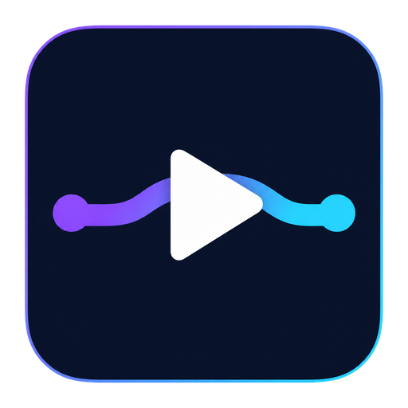

# Violet Relay - Free Windows Media Player with Apple TV AirPlay Casting

<p align="center">
  
</p>

<p align="center"><strong>Play here. Watch there.</strong></p>

[](https://github.com/ruhbyook/VioletRelay/actions/workflows/ci.yml)
[](LICENSE)
[](https://github.com/ruhbyook/VioletRelay/releases/latest)

Violet Relay is a free and open-source Windows 11 media player for local MKV,
MP4, MOV, audio, and other video files. It plays media on the PC and can
optionally cast local video from Windows to Apple TV over AirPlay, including a
selected embedded or external subtitle track.

Apple TV casting is an optional extra. You can use Violet Relay entirely as a
local player without owning an Apple TV or enabling network discovery.

## What Violet Relay is for

| Need | Violet Relay |
| --- | --- |
| Play local video and audio on Windows 11 | Hardware-accelerated playback, fullscreen controls, queues, tracks, and resume history |
| Cast an MKV or other local video from Windows to Apple TV | Direct streaming, fast remuxing, or automatic hardware conversion as required |
| Watch Apple TV playback with subtitles | Burns the selected embedded track or external subtitle into the outgoing stream |
| Resume a long movie or audiobook later | Saves unfinished local-media positions automatically |
| Avoid accounts, ads, subscriptions, and telemetry | GPL-licensed, free, open source, and local-first |

## Highlights

### Local playback

- Open or drag in common audio and video files supported by Qt's FFmpeg backend.
- Play direct MP4, MOV, and HLS media URLs.
- Choose embedded audio and subtitle tracks or add an external subtitle file.
- Resume long movies and audiobooks from the last saved position.
- Use a session queue, fullscreen mode, seeking, volume, mute, and speed controls.
- Add Violet Relay to Windows **Open with** without changing existing defaults.
- Convert a locally unsupported codec to a compatible copy when needed.

### Optional Apple TV casting

- Discover and pair an Apple TV on the same private network.
- Cast the media itself rather than mirror the Windows desktop.
- Start compatible files directly and prepare incompatible formats automatically.
- Burn selected subtitles into the cast when the receiver cannot render them.
- Use NVIDIA, AMD, Intel, or CPU conversion paths according to available hardware.
- Pause, resume, seek, stop, retry, or continue locally after a disconnection.

## Windows and Apple TV guides

- [How to cast an MKV from Windows 11 to Apple TV](docs/guides/cast-mkv-windows-to-apple-tv.md)
- [How to cast video with subtitles from Windows to Apple TV](docs/guides/cast-subtitles-windows-to-apple-tv.md)
- [Free AirPlay video casting from Windows 11](docs/guides/airplay-video-windows-11.md)

## Requirements

For local playback:

- Windows 11 x64

Only if you want Apple TV casting:

- An Apple TV on the same private network
- Windows network discovery and private-network firewall access

Python is not required for the portable release. FFmpeg is also not required
for ordinary compatible local playback. When casting or compatibility
conversion needs the optional media tools, Violet Relay offers to download and
verify them after you choose **Install**.

## Download

Download the latest ZIP from
[GitHub Releases](https://github.com/ruhbyook/VioletRelay/releases/latest),
extract the complete folder, and run `VioletRelay.exe`.

The public beta is unsigned, so Windows may show **Windows protected your PC**.
Verify the ZIP against the included `SHA256SUMS.txt`, then use **More info ->
Run anyway** only when the file came from this repository.

The public ZIP does not redistribute FFmpeg. If you approve the optional media
tools download, the archive and both executables are SHA-256 verified before
use.

## Getting started

### Play on this PC

1. Choose **Open** or drag a media file onto the window.
2. Use **CC** to select an embedded track or add an external subtitle file.
3. Close the player whenever you like. Reopening unfinished local media offers
   **Resume** or **Start over**.

Use **URL** for a direct, unauthenticated HTTP/HTTPS media URL. Web pages,
YouTube pages, DRM services, and URLs requiring custom authentication headers
are intentionally rejected.

### Cast to Apple TV

1. Put the PC and Apple TV on the same private network.
2. Open **AirPlay**, scan, and select the receiver.
3. Complete any AirPlay or Companion PIN prompts.
4. Before casting, use **CC** to select the subtitle track or external subtitle
   file you want on the television.
5. Open **AirPlay** again and choose **Cast**.

The selected subtitle is fixed when casting starts because Violet Relay builds
it into the outgoing stream. To change subtitles during a cast, stop casting,
choose the new track with **CC**, and start the cast again.

If Windows Firewall prompts while casting a local file, allow Violet Relay on
private networks. The Apple TV must be able to reach the temporary media server
running on the PC.

Use **Stop casting** to stop the receiver. Use **Continue here** to stop the
receiver and resume locally at the last confirmed cast position.

## Playback, subtitles, and resume history

Local-media positions are saved atomically every 15 seconds and whenever
playback pauses, stops, changes source, starts casting, or shuts down. A
lightweight content identity preserves the position across renames without
letting a replacement file at the same path inherit it. Violet Relay retains up
to 500 unfinished positions for two years and removes a position after natural
completion.

Text subtitles such as SRT, ASS, SSA, and WebVTT can render locally. Image
subtitles such as PGS can be burned into a compatibility copy after
confirmation. Selecting a subtitle for Apple TV casting burns it into the
temporary stream so the same captions appear on the television.

## Casting and conversion

Compatible files and direct HLS URLs start without a full conversion. Local
files are delivered through temporary fragmented HLS, and compatible MKV or AVI
streams can be copied into a short rolling buffer. This avoids waiting for an
entire movie-sized output file before playback begins.

When conversion is necessary, Violet Relay probes the installed graphics driver
and tries NVIDIA NVENC, AMD AMF, Intel Quick Sync, then CPU encoding. Incompatible
HDR sources can use a hardware HEVC streaming path or fall back to a cached
1080p SDR copy. Conversion progress is cancellable, partial files are removed,
and prepared copies are managed by a size-limited cache.

A cast is shown as **Playing** only after the Apple TV reports playback and, for
PC-hosted media, requests actual media bytes. Unexpected network loss leaves
local playback paused and offers **Retry casting** or **Continue here**.

## Windows integration

Violet Relay registers itself per user as an available **Open with** handler on
first launch. It does not take over file defaults automatically. In **Settings
and About**, choose **Make Violet Relay a default player** to open the Windows
Default Apps page, where Windows asks you to confirm each choice.

If the portable folder moves, Violet Relay can repair the registered executable
path. Choose **Remove Windows file integration** before permanently deleting the
application if you want to remove its registry entries.

## Privacy and local data

Violet Relay has no telemetry, advertising, analytics, accounts, or
developer-operated cloud service. Settings, resume history, encrypted pairing
credentials, optional media tools, prepared files, and redacted diagnostic logs
stay below `%LOCALAPPDATA%\VioletRelay`.

Pairing credentials are encrypted with Windows DPAPI for the current Windows
user. They cannot be moved to another user account or PC. Local media is served
only while a cast needs it and is never uploaded to the project maintainer.
See the full [privacy policy](PRIVACY.md).

## Current boundaries

- Windows 11 x64 only.
- Direct, unauthenticated HTTP/HTTPS media URLs only.
- No YouTube extraction, browser capture, DRM playback, desktop mirroring,
  updater, telemetry, or persistent media library.
- Compatible 4K/HDR may pass through unchanged. Incompatible sources use a
  reliable conversion path, which may reduce them to 1080p SDR.
- AirPlay integration is unofficial and may require adaptation after tvOS
  updates.

## AirPlay compatibility

Violet Relay uses the current AirPlay 2 queue command on tvOS 26 because the
legacy `pyatv` URL playback path no longer works reliably there. This path has
been tested on a physical Apple TV 4K running tvOS 26.5 with direct URLs,
PC-hosted files, subtitles, seeking, and stop/continue flows.

AirPlay support is based on the reverse-engineered `pyatv` project rather than
an Apple-provided Windows SDK. Violet Relay is not affiliated with, endorsed by,
or certified by Apple.

## Development

Install Python 3.13, open PowerShell in the repository, and run:

```powershell
.\scripts\bootstrap.ps1
.\scripts\run.ps1
```

The bootstrap creates `.venv`, installs the locked dependencies, downloads the
pinned FFmpeg build from a provider linked by ffmpeg.org, verifies its published
SHA-256, and installs `ffmpeg.exe` and `ffprobe.exe` under `vendor/ffmpeg/bin`.

Run the automated tests and build the portable application with:

```powershell
.\scripts\test.ps1
.\scripts\generate_test_fixtures.ps1
.\scripts\build.ps1
```

The build is created at `dist\VioletRelay\VioletRelay.exe`. Automated tests mock
the AirPlay protocol boundary; casting releases must also be checked on physical
hardware. See [RELEASING.md](RELEASING.md) for the complete release checklist.

## Support development

Every feature is free. If Violet Relay is useful to you, optional crypto tips
can support hardware testing and future development:

| Asset | Network | Public receiving address |
| --- | --- | --- |
| BTC | Bitcoin | `bc1q4udt9zp44v23c3geph6tq5h5a659xa0qqph2es` |
| ETH or USDC | Ethereum Mainnet only; USDC must be ERC-20 | `0xAd53452fB8ae492a96154D12aa671D3331AA6680` |

The in-app heart button displays offline QR codes and copies these public
addresses. It never connects a wallet or asks for a seed phrase, private key,
account, or personal information. Check the asset and network before sending;
crypto transfers are irreversible. Tips are optional and unlock nothing.

## License

Violet Relay is free software licensed under GPL-3.0-or-later. See
[THIRD_PARTY_NOTICES.md](THIRD_PARTY_NOTICES.md) and
[FFMPEG_SOURCE.md](FFMPEG_SOURCE.md) before redistributing a build.

See also [Privacy](PRIVACY.md), [Security](SECURITY.md),
[Code signing policy](CODE_SIGNING_POLICY.md),
[Contributing](CONTRIBUTING.md), and [Changelog](CHANGELOG.md).

AirPlay and Apple TV are trademarks of Apple Inc. Violet Relay uses these names
only to describe compatibility.

Copyright (c) 2026 Violet Relay contributors.
